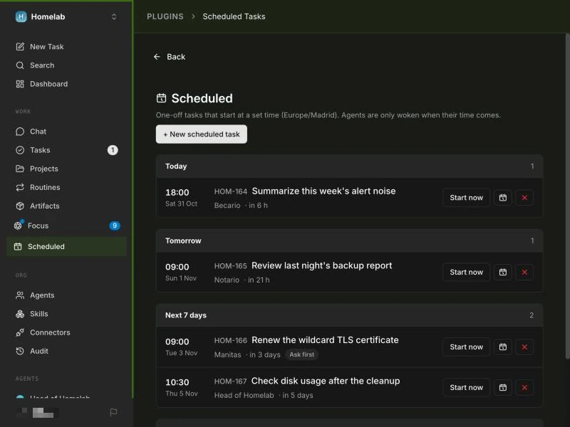
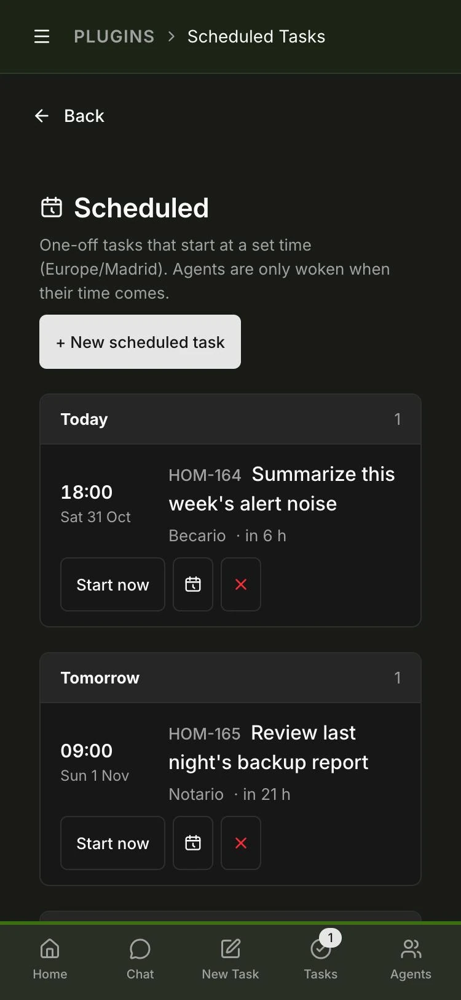
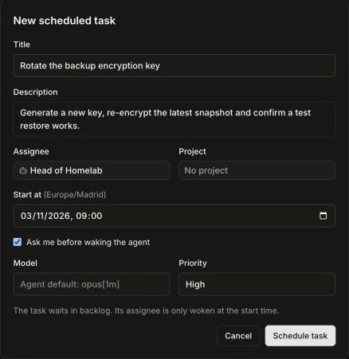
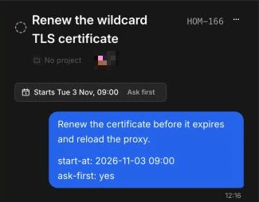
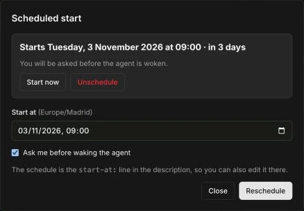
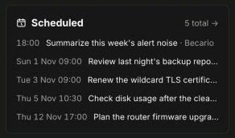

<p align="center">
  
</p>

<p align="center">
  <a href="#-install"><strong>Install</strong></a> &middot;
  <a href="#-how-to-use-it"><strong>How to use it</strong></a> &middot;
  <a href="#-scheduled-tasks-or-routines"><strong>vs routines</strong></a> &middot;
  <a href="#-for-agents-and-the-api"><strong>For agents</strong></a> &middot;
  <a href="https://github.com/paperclipai/paperclip"><strong>Paperclip</strong></a>
</p>

<p align="center">
  <a href="https://www.npmjs.com/package/paperclip-plugin-task-scheduler"></a>
  <a href="LICENSE"></a>
  <a href="https://github.com/paperclipai/paperclip"></a>
  
  
</p>

<br/>

# ⏰ Scheduled Tasks: start agent work at a set time in Paperclip

**Write the task today, pick its agent today, and the agent starts on the date you set.**

> I built this plugin because I kept scheduling one-off follow-ups by hand,
> like rotating a key in two weeks or reviewing a test once its trial period
> ends. Paperclip's routines are made for work that repeats. They run on a cron
> schedule and create a new task each time, so a single date meant writing a
> yearly cron that had to switch itself off after the first run. Now the task
> sits in Paperclip from the first day, with its agent, its notes and its
> files, and starts on its own when its time comes. I'd love to hear your
> feedback!

A [Paperclip](https://github.com/paperclipai/paperclip) plugin for one-off
tasks with a start date, much like the "Upcoming" list of a to-do app. The
task waits in backlog with its assignee already set. At the start time the
plugin moves it to todo and wakes the agent.

<br/>

## Scheduled Tasks is right for you if

- ✅ You keep **follow-ups for later**: renewals, reviews, a check on Monday morning
- ✅ You want the agent **assigned now** but **woken later**
- ✅ Your agents should be able to **schedule work for each other**
- ✅ You've written a **routine that only ever needs to run once**

<br/>

## Features

<table>
<tr>
<td align="center" width="33%">
<h3>🗓️ Upcoming view</h3>
Today, Tomorrow, Next 7 days and Later. Start, reschedule or unschedule from any row.
</td>
<td align="center" width="33%">
<h3>⏰ Starts on time</h3>
A job checks every minute, moves due tasks to todo and wakes their agents through Paperclip's own heartbeat.
</td>
<td align="center" width="33%">
<h3>🙋 Ask me first</h3>
An optional confirmation card at the start time, so you decide before the agent wakes up.
</td>
</tr>
<tr>
<td align="center">
<h3>📎 Files and images</h3>
Attach them while you schedule, or paste and drop images into the description. Images show inline in the task, and nothing wakes the agent early.
</td>
<td align="center">
<h3>🤖 Agents schedule too</h3>
A bundled Paperclip skill teaches them how. They create one with the normal issues API or the <code>schedule-task</code> tool.
</td>
<td align="center">
<h3>🧠 Model per task</h3>
Pick a model for that run only, with the same override Paperclip's New Issue dialog uses.
</td>
</tr>
<tr>
<td align="center">
<h3>🔓 No lock-in</h3>
The date is a line in the task itself. Uninstall the plugin and you lose nothing.
</td>
<td align="center">
<h3>📱 On your phone</h3>
The list, the dialog and the task button work at phone width.
</td>
<td align="center">
<h3>🔁 Routines stay routines</h3>
Recurring work keeps running on Paperclip's routines. This plugin covers the one-off dates.
</td>
</tr>
</table>

<p align="center">
  
</p>

<br/>

## 📦 Install

Scheduled Tasks needs Paperclip 2026.1023.0 or later.

**From npm** (recommended):

```bash
paperclipai plugin install paperclip-plugin-task-scheduler
```

**From source:**

```bash
git clone https://github.com/TrasteCC/paperclip-plugin-task-scheduler.git
cd paperclip-plugin-task-scheduler
pnpm install
pnpm build
paperclipai plugin install /path/to/paperclip-plugin-task-scheduler
```

The installable package is `package.json` plus `dist/`; `node_modules/` is not
needed at runtime.

Then turn it on in each company: open Company Settings > Plugins > Scheduled
Tasks, switch on **Start scheduled tasks in this company** and click Save
Configuration. Paperclip lets a plugin's background job act only in companies
where the plugin has a saved configuration, so a company without one never
starts its tasks. The Scheduled page shows a warning when the switch is off.

The plugin asks to read and update issues, add comments and confirmation
cards, read agents and wake them, and keep its own state. It also registers
one scheduled job, one agent tool, one managed skill, and the page, sidebar,
toolbar button and dashboard widget slots. The full list is in
[`src/manifest.ts`](src/manifest.ts).

**Teach your agents.** Once a company is enabled, the plugin adds a
**Scheduled tasks** skill to that company's Skills library. Attach it to every
agent that should be able to schedule work, from the agent's Skills tab or
with the API:

```bash
curl -X POST "$PAPERCLIP_URL/api/agents/<agent-id>/skills/sync" \
  -H "Authorization: Bearer $PAPERCLIP_BOARD_KEY" \
  -H "Content-Type: application/json" \
  -d '{"mode": "add", "desiredSkills": ["plugin/traste-task-scheduler/scheduled-tasks"]}'
```

`add` keeps the agent's other skills. Attach it to new agents when you create
them.

## 🚀 How to use it

1. Open **Scheduled** in the sidebar and click **New scheduled task**.
2. Write the title and description, pick the agent (or a person) and the start
   time, and attach any files or images. You can also set a project, a model
   for this run, the priority, and **Ask me before waking the agent**.
3. Click **Schedule task**, or **Schedule and open** to land on the new task.
   The task waits in backlog. It doesn't show in the agent's inbox, and nothing
   wakes the agent before the start time.

<p align="center">
  
</p>

Put files and context in the dialog rather than in a comment on the task page.
In Paperclip, a comment from a person wakes the task's agent right away, even
while the task is in backlog.

Any backlog or todo task can be scheduled from its own page as well. The
button under the task header reads **Schedule…**, or the start time once it has
one, and opens a panel to reschedule, start now or unschedule.

<table>
<tr>
<td align="center" width="50%"></td>
<td align="center" width="50%"></td>
</tr>
</table>

The dashboard gets a **Scheduled** card with the next five starts.

<p align="center">
  
</p>

### ⏰ What happens at the start time

| Task | At the start time |
|---|---|
| Assigned to an agent | Moves to todo, gets a comment, and the agent is woken |
| Assigned to an agent, **ask first** on | A confirmation card appears on the task. Accepting starts it as above; declining keeps it in backlog |
| Assigned to a person | Moves to todo with a comment, so it shows in their inbox |
| Date it can't read | Stays in backlog with a comment that explains the expected format |

If the agent can't be woken (paused, out of budget, or blocked by another
task), the task still moves to todo and the reason is posted as a comment.

## 🔁 Scheduled tasks or routines?

Both start agent work on their own. The difference is what they are for:

| | Paperclip routines | Scheduled Tasks |
|---|---|---|
| Made for | Work that repeats: every morning, every Monday | One-off work on a given date |
| What triggers it | A cron schedule, a webhook or an API call | The `start-at` date and time on the task |
| The task | A new task is created at every run | One task, created when you schedule it |
| Before it runs | Only the routine exists | The task is already in backlog with its agent, description and files |
| A single date | A cron has no year, so it needs a yearly schedule that you switch off after the first run | Pick the date |

## 🤖 For agents (and the API)

Paperclip tasks have no date field, so the schedule lives in two lines of the
task description. The date picker writes them for you:

```
start-at: 2026-11-02 09:00
ask-first: yes
```

`start-at` is wall-clock time in Europe/Madrid. An ISO time with `Z` or an
offset (`2026-11-02T08:00Z`) also works, and `ask-first` is optional.

Any agent, script or person can schedule work through the normal issues API,
without the plugin's tool. Create a **backlog** task with its assignee and the
line:

```bash
curl -X POST "$PAPERCLIP_API_URL/api/companies/$COMPANY_ID/issues" \
  -H "Authorization: Bearer $PAPERCLIP_API_KEY" \
  -H "Content-Type: application/json" \
  -d '{
    "title": "Fix the disk alert",
    "status": "backlog",
    "assigneeAgentId": "<agent-id>",
    "description": "Free some space on the backup disk.\n\nstart-at: 2026-11-02 09:00"
  }'
```

Agents learn all of this from the **Scheduled tasks** skill, whose source is
[`skill/SKILL.md`](skill/SKILL.md). The plugin restores that text in every
company each time it starts, so change the file in the repo rather than in
Paperclip.

Agents that get plugin tools can also call **`schedule-task`**:

| Parameter | Required | Meaning |
|---|---|---|
| `title` | yes | Task title |
| `assignee` | yes | Agent name, as shown in Paperclip |
| `startAt` | yes | `YYYY-MM-DD HH:MM`, Europe/Madrid |
| `description` | no | Markdown |
| `askFirst` | no | Ask a board user before waking the agent |
| `model` | no | Model override for this task only |
| `parentIssueId` | no | Parent task |
| `priority` | no | `critical`, `high`, `medium` or `low` |

## 🗄️ Where the data lives

The schedule is in the task, so it survives plugin upgrades and reinstalls and
you can edit it from the task page. It never fires twice: once the task
starts, the key becomes `started-at:`, or `start-declined:` after a declined
confirmation, or `start-at-invalid:` for a date it can't read. The line stays
as history.

Files are normal Paperclip attachments on the task. The plugin lists them
under **Attachments** in the description, just above the `start-at` line. An
image pasted or dropped into the description stays where you put it, and
Paperclip attaches it to the task when the task is created.

The plugin's own state holds only the id of a pending confirmation card, and
its configuration holds `{ "enabled": true }` for each company.

A time skipped by a daylight-saving jump moves forward by the jump, so 02:30
on the spring-forward day starts at 03:30. A time that happens twice when the
clocks go back uses the second occurrence.

## ⚙️ How it works

| Piece | What it does |
|---|---|
| Job `start-due-tasks` (`* * * * *`) | Lists backlog tasks in each enabled company, finds due `start-at` lines, moves them to todo and wakes the assignee. A failure on one task doesn't stop the others. |
| `page` + `sidebar` | The **Scheduled** page and its sidebar link. |
| `toolbarButton` on issues | The button under the task header. Paperclip's chat-style task page hides the tab strip, so a `detailTab` would never show. |
| `dashboardWidget` | The **Scheduled** card. |
| Tool `schedule-task` | Creates a scheduled task for an agent. |
| Managed skill `scheduled-tasks` | Added to each enabled company's Skills library on the first job run after the plugin starts, and reset to the plugin's text if the stored copy differs. |
| File upload | The dialog uploads each file with `POST /api/companies/:id/issues/:id/attachments`, the route Paperclip's own editor uses, then links it in the description. An upload doesn't wake the agent. |
| Pasted images | The description editor gets an `imageUploadHandler`, like the one in Paperclip's own new-task dialog. It uploads the image as a draft (`POST /api/companies/:id/assets/images`), and Paperclip attaches drafts to the task when the same person creates it. |

The plugin relies on how Paperclip treats backlog tasks. Assigning an agent to
a backlog task doesn't wake it, and an agent's inbox lists only todo, in
progress and blocked tasks. Paperclip also refuses to wake an agent on a
backlog task, so at the start time the plugin changes the status first and
wakes the agent second. The UI uses the SDK's components (assignee and project
pickers, markdown editor, toasts) and Paperclip's theme variables, so it
looks like the rest of Paperclip.

## 🛠️ Building from source

The toolchain matches Paperclip's plugin scaffold: esbuild with the SDK's
`createPluginBundlerPresets`, Vitest and TypeScript. `@paperclipai/plugin-sdk`
and `@paperclipai/shared` are pinned to `2026.1023.0`; change the pin to match
the Paperclip you run.

```bash
pnpm install
pnpm typecheck
pnpm test        # schedule parsing (incl. daylight-saving edges), the worker, the agent tool and the skill
pnpm build       # also regenerates src/skill.ts from skill/SKILL.md (pnpm sync-skill)
```

To update an installed copy, replace `package.json` and `dist/`, then run
`POST /api/plugins/<id>/upgrade`. After any Paperclip or plugin upgrade, check
that the `start-due-tasks` job has a recent successful run. The health check
only looks at the plugin registry, so it can pass while the job is stopped.

## ⚠️ Known limits

- The time zone is fixed to Europe/Madrid (`TIMEZONE` in `src/schedule.ts`).
- The date shows as a line in the task description, because Paperclip has no
  date field for tasks and plugins can't add one.
- The skill reaches an agent only once it's attached to that agent. Paperclip
  has no switch for all agents, and a plugin can't change existing agents.
- A comment from a person on a scheduled task wakes its agent at once. Add
  context and files in the dialog or the description instead.
- File upload uses Paperclip's attachment route, which isn't part of the plugin
  SDK. If a Paperclip release changes it, uploads stop working and scheduling
  carries on.
- Image paste uses an editor prop, `imageUploadHandler`, that the SDK doesn't
  declare. If a release stops passing it to the editor, pasted images are
  ignored and the rest of the dialog keeps working.
- A model override can only be set when the task is created, and only for
  `claude_local`, `codex_local` and `opencode_local` agents.
- Tasks start within about a minute of their time.
- Paperclip refuses an upgrade that adds a capability. As of 2026.1023 a
  refused upgrade also leaves the plugin unloaded while it still reports
  `ready`, so adding one means uninstalling and reinstalling.

## 📄 License

MIT
